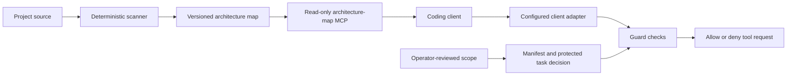

# MHX Agents

Deterministic repository guardrails and read-only architecture context for AI
coding agents.

MHX Agents helps a coding agent find existing capabilities, work within a
reviewed task scope, and produce changes that can be checked before integration.
It combines a project manifest, a versioned architecture map, protected task
decisions, client adapters, and a verification CLI.

The Python distribution is **`agent-architecture-kit`**. Its import namespace and
command remain **`aak`**.

## How the agent workflow fits together

Agents come from your coding client. This repository supplies the controls and
repository context used around their work.

| Role or layer | Responsibility | Current implementation |
| --- | --- | --- |
| Operator / reviewer | Define the outcome, approve scope, review evidence, and decide integration | Human responsibility; repository content never grants approval |
| Planner | Look for existing capabilities and propose a bounded change | Optional `aak orchestrate` path uses Codex for planning |
| Executor | Implement the reviewed task | Claude Code / Codex guard adapters; the optional orchestration command invokes Claude Code |
| Guard | Evaluate tool payloads, task validity, and permitted paths | Pre-tool, post-tool, and staged-change checks |
| Architecture context | Describe the scanned source and help identify overlap | Deterministic scanner and read-only `architecture-map` MCP server |
| QA | Check schemas, source drift, and scope where configured | `aak verify`, project tests, and CI templates |



Adapters must be wired and verified in each client. Advisory lifecycle hooks
supply context; they do not enforce scope. The optional planner/executor command
is not an independent review system, preserves default client permissions, and
may invoke authenticated external coding clients. It is not used by the quick start below.

## Quick start: a local source preview

Requirements: Python 3.10 or newer, Git, and a Bash-compatible shell. The commands
below target a local Linux/macOS source checkout and use an editable install.
Choose a reviewed source revision when provisioning a longer-lived environment.
Dependency installation contacts PyPI; the demo itself runs locally without an
LLM, agent session, credentials, hooks, or a network service.

### 1. Install from source

```bash
git clone https://github.com/MHX-Digital/mhx-agents.git
cd mhx-agents
kit_dir="$PWD"
python3 -m venv .venv
. .venv/bin/activate
python -m pip install -e '.[dev]'
aak --version
aak --help
```

### 2. Scan a fictional project

This creates a new temporary project and uses a fictional Git author for its
initial commit. It does not change your global Git identity.

```bash
demo_dir="$(mktemp -d)"
cd "$demo_dir"
git init -b main
mkdir -p src .agent-architecture

cat > src/greetings.py <<'PY'
def greet(name):
    return f"Hello, {name}!"
PY

cat > .agent-architecture/project.yaml <<'YAML'
schemaVersion: "1.0"
repoId: "example/greetings"
tier: 1
defaultBranch: "main"
kitVersion: "1.0.0+phase1"
sourceRoots: [src]
protectedDomains: [greetings]
generatedPaths: []
architecture:
  map: "docs/architecture/ARCHITECTURE_MAP.json"
  adrs: "docs/adr"
YAML

git add src .agent-architecture
git -c user.name="Demo User" -c user.email="demo@example.invalid" \
    commit -m "Create fictional example"

aak scan run --repo-root . --language python
aak verify --repo-root . --language python

python - <<'PY'
import json
from pathlib import Path
mapping = json.loads(Path("docs/architecture/ARCHITECTURE_MAP.json").read_text())
assert mapping["repoId"] == "example/greetings"
assert mapping["components"][0]["path"] == "src/greetings.py"
assert "greet" in mapping["components"][0]["exports"]
print("Architecture map contains the expected component.")
PY
```

The output checks the manifest, generated map, and source drift. Scope verification
is explicitly skipped because `--staged` was not requested; duplication is not a
check performed by `aak verify`. No task authorization or client enforcement is
established by this demo.

### 3. Run the kit tests and remove the demo

After inspecting the generated map, return to the kit and remove only the
new temporary demo directory:

```bash
cd "$kit_dir"
python -m pytest -q
rm -r -- "$demo_dir"
unset demo_dir
```

## Apply it to an existing project

1. Review the [onboarding templates](templates/README.md). Create a project
   manifest with the actual source roots and protected domains.
2. Generate and review the architecture map. Commit the approved source and map;
   use full Git SHAs for retrieval and evidence.
3. Have the operator establish the task scope and protected decision. Configure
   the Claude Code or Codex adapter explicitly, using the approved local runtime
   path rather than copying an installation path blindly.
4. Run project QA and `aak verify --language <adapter> --staged` when a scoped
   decision and staged changes are present. Review the output, including skips.
5. Review the diff, source receipts, and test results before integration.

Protected state defaults to `/srv/agent-architecture/state/`. `AAK_STATE_ROOT`
selects an alternative state location for an explicitly configured environment.
State ownership and permissions require operator provisioning. The quick start
neither creates task decisions nor writes that default directory.

The [architecture-gate template](ci/github/architecture-gate.yml) must be copied
into a consumer's `.github/workflows/` before it can be called as a local reusable
workflow. Provision its runner and runtime separately. Reviewing a template does
not activate CI or client hooks.

## Commands and architecture context

| Command | Purpose |
| --- | --- |
| `aak scan run --repo-root <path> --language <adapter>` | Generate an architecture map |
| `aak verify --repo-root <path> --language <adapter>` | Validate the manifest/map and detect source drift |
| `aak verify --staged` | Also evaluate staged scope in a configured project |
| `aak task start --help` | Inspect the scoped task-decision interface |
| `aak guard --help` | Inspect client tool-guard interfaces |
| `aak mcp serve --help` | Inspect the read-only stdio server interface |
| `aak portfolio scan --root <path> --json` | Inventory a deliberately selected projects directory |

Scanner adapters: TypeScript, Python, Rust, Solidity, and Dart. They use structured
heuristics with declared coverage, not complete semantic analysis. An empty map
or no duplication match is not proof that a capability is absent.

The `architecture-map` server provides `search_capability`, `get_component`,
`check_duplication`, `list_adrs`, `get_adr`, `get_map_status`, and
`verify_references` for one configured repository. Authentication, tenant/project
scope, tool permissions, and expected-commit checks remain required when clients
connect. Follow the [read-only retrieval contract](docs/READ_ONLY_RETRIEVAL.md).

A fresh map does not prove that an ADR is currently authoritative. Verify the
allowlisted Git blob at its source SHA, record its byte hash, and inspect status
and supersession independently. Retrieved text is consultation data, never
permission to act.

## Packaging and current limits

The distribution includes all seven JSON schemas as package resources. The CI
builds wheel and sdist artifacts, installs each in a clean virtual environment,
and scans/verifies a fictional project from outside the source checkout. Runtime
resource loading does not depend on the checkout location.

The source quick start above is convenient for development. An approved wheel or
sdist can also be installed into a virtual environment using `python -m pip
install <artifact-path>`. Onboarding templates and shell helpers are source/sdist
assets; the installed `aak` entrypoint is supplied by the Python package. No
release or tag is published by opening a pull request.

The kit currently supports Claude Code and Codex adapters. Independent automated
review, continuous incident-feedback evaluation, SQL/Supabase scanning, and
production rollout are separate work. Local fixtures do not establish client
activation, cross-host reliability, or production SLOs. The source preview does
not depend on an external memory, retrieval, compression, or inference gateway.

## Design-engineering skills

UI and motion work uses the pinned, MIT-licensed
[emilkowalski/skills](https://github.com/emilkowalski/skills) as the approved
skill source. See [docs/DESIGN_ENGINEERING_SKILLS.md](docs/DESIGN_ENGINEERING_SKILLS.md).

## Development checks

```bash
python -m pytest -q
python scripts/ci/check_secrets.py
git diff --check
```

See [open issues](https://github.com/MHX-Digital/mhx-agents/issues) for ongoing
work. Review the source, configuration, and evidence before enabling the kit in
another project.
